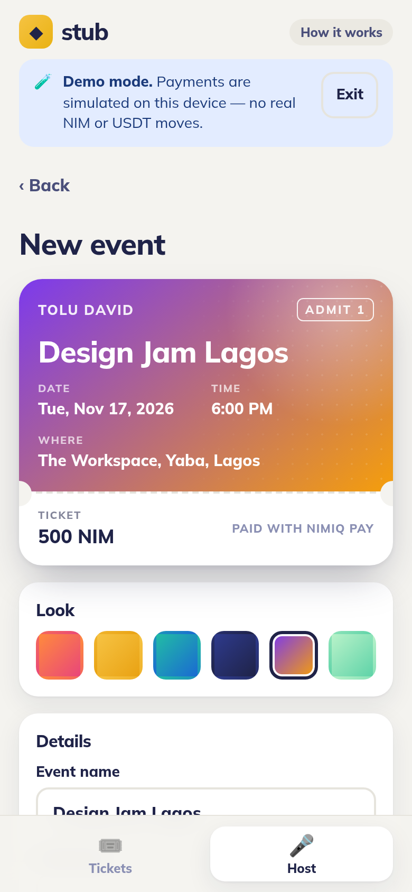
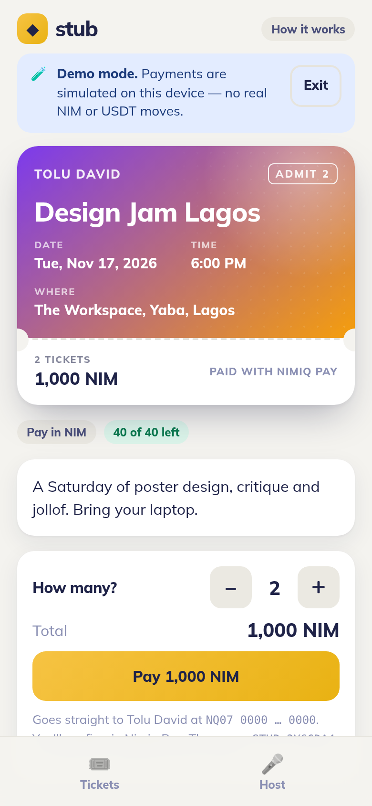

# Stub — event tickets paid with Nimiq Pay

**Sell tickets to your meetup, class or party in NIM or USDT. Share one link, get paid wallet‑to‑wallet, and scan guests in at the door.**

Stub is a [Nimiq Pay](https://nimiq.com) Mini App built for the Nimiq Mini Apps Competition, Cycle III (**Pay** category).

| Host | Guest | Door |
| --- | --- | --- |
|  |  |  |

## Who it's for

Small organizers who today sell tickets by "send me money and DM me the receipt": design meetups, workshops, church and campus events, owambe parties, tech hangouts, pop‑ups. Ticket platforms are slow to pay out, take a cut, and often don't work in their country. With Stub the money lands in the host's own wallet the moment a guest pays, and the guest list builds itself from the blockchain.

## What it does

**Host**
- Create an event in under a minute: name, date, venue, price (NIM or USDT on Polygon), capacity and a ticket colour theme, with a live ticket preview.
- "Use my Nimiq Pay address" fills the payout address from the wallet (`listAccounts()` / `eth_requestAccounts`).
- Share the event as a Nimiq Pay deeplink, or generate a 1080×1350 **poster** with a QR code for WhatsApp status, Instagram or X.
- Live dashboard: tickets sold, NIM received and guests, read directly from the host's on‑chain history. Export the guest list as CSV.
- **Door mode**: scan ticket QRs with the camera (Nimiq's own `qr-scanner`) or paste a code. Each scan is verified on‑chain. It shows a full‑screen green **ADMIT n**, amber **ALREADY CHECKED IN**, or red **DO NOT ADMIT** with the reason.

**Guest**
- Open the link in Nimiq Pay, choose how many tickets, and tap **Pay**. There's one native approval and no sign‑up.
- The ticket is a designed pass with a QR code. It shows *Confirming → Confirmed* as the payment lands on‑chain, and a full‑screen mode for the door.
- "My tickets" keeps upcoming and past tickets on the phone.

## How it uses Nimiq Pay

| Feature | API |
| --- | --- |
| Provider bootstrap with graceful fallback outside Nimiq Pay | `init()` from `@nimiq/mini-app-sdk` |
| NIM payment with an on‑chain memo `STUB:<eventId>:<qty>` | `nimiq.sendBasicTransactionWithData()` |
| Fill the payout address, check the buyer's balance before paying | `nimiq.listAccounts()`, `nimiq.getBalance()` |
| Mainnet/testnet awareness (testnet events are labelled, and a network mismatch blocks payment) | `getHostNetwork()` |
| Full‑screen ticket at the door | `window.nimiqPay.requestFullscreen()` |
| USDT tickets (ERC‑20 `transfer` on Polygon, chain switch to `0x89`) | `window.ethereum` + `viem` |
| Wallet errors (user cancel = calm message, network error = "check before paying again") | `NimiqProviderError` |

**The payment is the ticket.** Each NIM payment carries a public memo that ties it to the event and the quantity. At the door Stub fetches the transaction from a public Nimiq RPC and checks four things: it was paid to this host, the memo matches this event, at least `price × qty` was paid, and it's confirmed and executed. The first scan wins (check‑ins are stored on the door phone), so a screenshot of a QR code can't get in twice.

USDT on Polygon has no memo, so a USDT ticket is matched by recipient, amount (`qty = amount / price`) and time (it must be paid after the event was created). USDT buyers need a little POL for gas, as the Nimiq docs note for mini‑app ERC‑20 transfers.

## Architecture (no backend, no custody)

- The **event is the link**: its details are base64url JSON in `?e=…`. It has no database and no accounts, and Stub never holds anyone's money.
- **Reads** go to open RPC servers listed at nimiq.dev: `rpc.nimiqwatch.com` (mainnet) and `rpc.testnet.nimiqwatch.com` (testnet). USDT reads use `polygon-bor-rpc.publicnode.com`.
- **Local storage** holds my events, my tickets and door check‑ins, all on the device.
- **Demo mode** lets you try every screen in a normal browser with simulated payments. It's clearly labelled, and no wallet or chain is touched.

```
src/
  lib/event.ts    event model, share-link encoding, memo + ticket codes, integer money math
  lib/wallet.ts   the only file that talks to Nimiq Pay providers (NIM + EVM)
  lib/rpc.ts      read-only chain queries (Nimiq JSON-RPC, Polygon receipts)
  lib/verify.ts   door verification rules (pure, unit-tested)
  lib/poster.ts   canvas poster generator
  lib/demo.ts     simulated ledger for demo mode
  views/          Tickets, Host, CreateEvent, EventPage, TicketView, Manage, Door, About
tests/core.test.ts
```

## Run it

Requirements: Node.js 22 or newer, and Nimiq Pay on a phone on the same Wi‑Fi.

```bash
npm install
npm run dev -- --host      # open the Network URL (http://192.168.x.x:5173) in Nimiq Pay → Mini Apps
npm test                   # unit tests (addresses, links, memo, money math, door rules)
npm run build              # production build in dist/
```

To test with free NIM, switch Nimiq Pay to **Testnet**: long‑press Settings for 10 seconds, pick Testnet, then tap "Get free NIM". Events created on testnet are labelled and verified against the testnet RPC.

## Deploy

`dist/` is a static site that runs on any static host (it uses hash routing and relative asset paths).
- **Netlify**: connect the repo (`netlify.toml` is included), or drag `dist/` onto app.netlify.com/drop.
- **Vercel / GitHub Pages / Cloudflare Pages**: build command `npm run build`, output `dist`.

Share link format: `https://nimpay.app/miniapps/open/<your-host>/?e=<event>`

## Privacy

Stub collects no personal data and has no server. Payments and memos are public on‑chain by nature. Chain lookups go to the public RPC servers named above.

## License

MIT © 2026 Tolu David. It uses `@nimiq/mini-app-sdk`, `qr-scanner` (Nimiq), `qrcode`, `viem`, `vue` and `@fontsource/mulish`, all under their own open‑source licenses.
